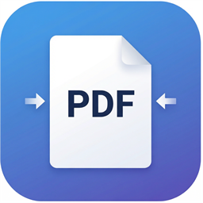

# PDF Binder

一个极简的 PDF 合并工具：选择若干 PDF、调整顺序、合并成一份。使用 **Rust + egui/eframe** 构建，后端用 `lopdf` 逐份读取文档、重新编号对象后拼成一份，无 WebView、无 Electron。

[](https://github.com/liuzhh/PDFBinder/actions/workflows/ci.yml)
[](./LICENSE)




## 特性

- 两种添加方式：文件对话框（可多选）、直接拖进窗口
- 列表内上移 / 下移 / 移除，严格按列表顺序合并
- 添加时读取每份 PDF 的页数，底部实时显示「文件数 · 总页数」
- 合并后重新打开产物校验页数，页数不符立即报错，不会静默产出损坏文件
- 页面继承属性（`MediaBox` / `CropBox` / `Resources` / `Rotate`）先固化到每一页，再重建扁平页面树，页序与尺寸不漂移
- 只设置了权限密码、打开密码为空的 PDF 可以直接合并
- 纯 Rust 实现，无 WebView 依赖；release 配置 `lto` + `strip` + 静态 CRT，产物是单个不依赖 VC++ 运行库的 exe
- 界面中文，使用系统自带中文字体（不内置字体，体积更小）

## 下载安装

从 [Releases](https://github.com/liuzhh/PDFBinder/releases) 下载最新的 `pdfbinder-*-windows-x64.zip`，解压后双击 `pdfbinder.exe` 即可，无需安装。

> 未做代码签名，首次运行 SmartScreen 可能提示「未知发布者」，点击「更多信息 → 仍要运行」即可。

## 从源码构建

### 前置条件

- **Windows 10 / 11**（当前唯一验证与发布的平台）
- [Rust](https://rustup.rs/) **1.95+**（`edition 2024` 与 `eframe 0.37` 的要求）
- **MSVC 工具链**：Visual Studio 或 Build Tools 的「使用 C++ 的桌面开发」工作负载

### 步骤

```powershell
cargo build --release
# 产物：target\release\pdfbinder.exe
```

当前终端没有 MSVC 环境变量、`cargo` 报找不到 `link.exe` 时，用仓库里的脚本自动定位 Visual Studio 并进入编译环境（通过 `vswhere` 探测，支持 Community / Professional / Enterprise 及任意版本与安装路径）：

```powershell
pwsh -File scripts/build.ps1          # cargo build --release
pwsh -File scripts/build.ps1 -Test    # 改为跑 cargo test
```

项目里的 [`.cargo/config.toml`](./.cargo/config.toml) 为 Windows target 启用了 `+crt-static`，让产出的 exe 不依赖 VC++ 运行库。如果到 crates.io 的速度不理想，可以把镜像配置写进全局的 `%USERPROFILE%\.cargo\config.toml`，不要修改仓库内的这个文件。

## 测试

```powershell
cargo test
```

`src/merge.rs` 的单元测试在临时目录里用 `lopdf` 现场生成 PDF，覆盖：合并顺序、页面内容跟随页面（不错位）、倒序合并、输出页数校验。测试不依赖仓库内的任何样例文档。

### 为什么不提交真实 PDF

PDF 常用来承载合同、发票、证件扫描件，这类文件里包含**姓名、证件号、金额、签名和印章**。把真实文档提交进公开仓库等于泄露个人信息，因此：

- `*.pdf` 在 [`.gitignore`](./.gitignore) 中
- 测试用的 PDF 全部由 `src/merge.rs` 里的 `sample_pdf()` 在运行时生成
- 想用真实文档做手工测试，请放在本地，不要提交

## 项目结构

```
├── src/
│   ├── main.rs            # egui 界面：文件列表、拖拽、对话框
│   └── merge.rs           # 合并逻辑 + 单元测试
├── assets/
│   ├── icon-source.png    # 图标源图
│   ├── icon-preview.png   # 裁切 / 透明处理后的预览图（README 使用）
│   ├── icon.ico           # build.rs 嵌入 exe 的多尺寸图标
│   └── icon64.rgba        # 窗口 / 任务栏图标（未预乘 RGBA）
├── tools/
│   └── make-icon.ps1      # 从源图重新生成 ico 与 RGBA
├── scripts/
│   ├── build.ps1          # Windows MSVC 环境自动配置
│   └── bump-version.mjs   # 发版：同步版本号 + 提交 + 打 tag
├── .cargo/
│   └── config.toml        # 静态链接 CRT（仅 Windows target）
├── .github/
│   ├── workflows/         # CI 与 Release
│   └── ISSUE_TEMPLATE/    # Issue 模板
└── build.rs               # 把图标与版本信息写入 Windows 资源段
```

## 已知限制

- **不合并书签 / 大纲**：源文档的 `Outlines` 会被丢弃，`Catalog` 中的对应入口也会移除
- **不支持需要打开密码的 PDF**：只有权限密码、打开密码为空的文件可以合并
- **数字签名会失效**：合并重写了对象编号与页面树，原签名不再有效，也不做签名校验
- **高级结构未做专门处理**：交互表单、注释、附件等对象会随文档复制，但跨文档的字段重名、行为差异未做验证
- **中文依赖系统字体**：从微软雅黑 / 黑体 / 宋体 / 等线中依次查找，系统缺少这些字体时界面文字可能无法显示
- **仅支持 Windows**：未提供 macOS / Linux 构建（字体加载与窗口行为只在 Windows 上验证过）
- **大文件占用内存较高**：文档整体载入内存，超大的 PDF 请留意内存占用

## 常见问题

- **`cargo` 报找不到 `link.exe`**
  当前终端没有 MSVC 环境变量，用 `pwsh -File scripts/build.ps1`。

- **双击 exe 被 SmartScreen 拦截**
  发布产物没有代码签名，属预期行为；确认来源后选择「仍要运行」。

- **合并后的文件为什么和源文件总和差不多大？**
  合并是对象级的逐份复制，不做跨文档去重或重新压缩，体积基本等于各源文件之和。

- **保存的默认文件名是什么？**
  `<第一个文件名>-合并.pdf`，可以在保存对话框里修改。

## 发布新版本

```powershell
node scripts/bump-version.mjs 0.2.0
git push origin main v0.2.0
```

[`scripts/bump-version.mjs`](./scripts/bump-version.mjs) 会校验版本号格式与递增、确认 tracked 文件没有未提交的改动、确认同名 tag 不存在，然后把版本同步进 `Cargo.toml` 与 `Cargo.lock`，提交 `release: v0.2.0` 并打上 `v0.2.0` tag。推送 tag 后 Release workflow 会在 Windows runner 上构建并创建 GitHub Release。

> 首次发布 `v0.1.0` 时版本号还没有 bump 过，直接提交后手动打 tag 即可：`git tag v0.1.0`。
>
> 发版脚本需要 Node 18+；构建本身不需要 Node。

## 贡献

欢迎提交 Issue 和 PR，详见 [CONTRIBUTING.md](./CONTRIBUTING.md)。

## 许可证

[MIT](./LICENSE)

---

## English

**PDF Binder** is a tiny Windows PDF merger built with Rust, egui/eframe and
lopdf. Pick files, reorder them in the list, and merge everything into a single
PDF. There is no WebView and no bundled font.

- Add files via the dialog (multi-select) or by dropping them onto the window
- Move entries up/down, remove them; the merge follows the list order
- Per-file page counts are read on add and checked again by reopening the
  merged output, so a broken result is never reported as success
- Inherited page attributes (`MediaBox`, `CropBox`, `Resources`, `Rotate`) are
  materialized before the flat page tree is rebuilt
- PDFs with an empty open password (permissions-only encryption) are supported
- Release builds use LTO, `strip` and the static CRT: one self-contained exe

```powershell
cargo build --release   # target\release\pdfbinder.exe
cargo test              # merge tests, fixtures generated in code
```

Requires Rust 1.95+ with the MSVC toolchain. Test PDFs are generated at runtime
and never committed, because real documents routinely embed personal data.
Only Windows is supported and released today.

Licensed under the [MIT License](./LICENSE). Releases: run
`node scripts/bump-version.mjs 0.2.0` to bump the manifests, commit and tag;
pushing the tag publishes the Windows build automatically.